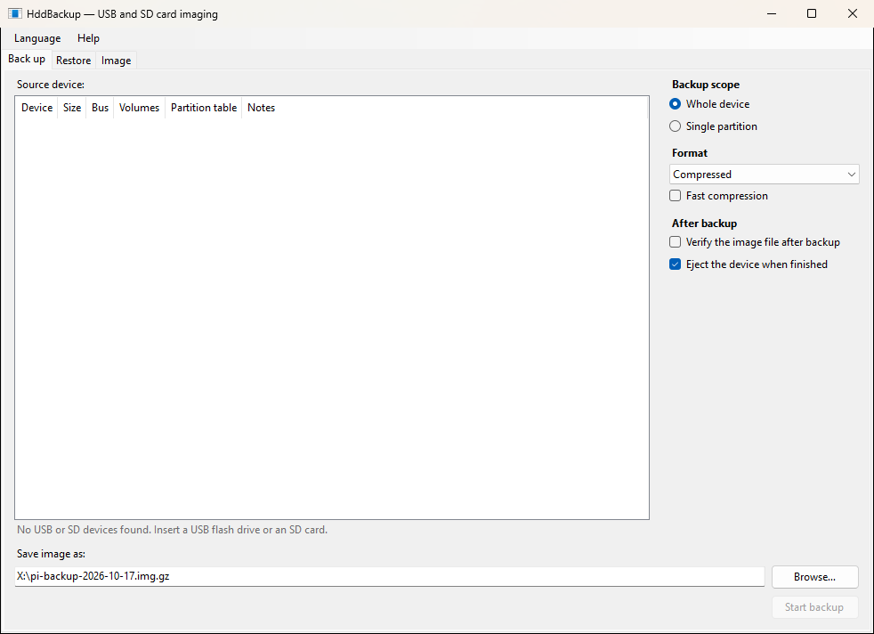
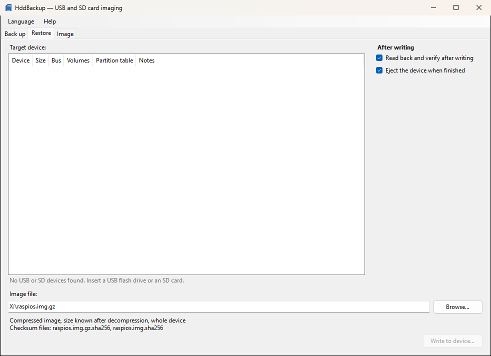
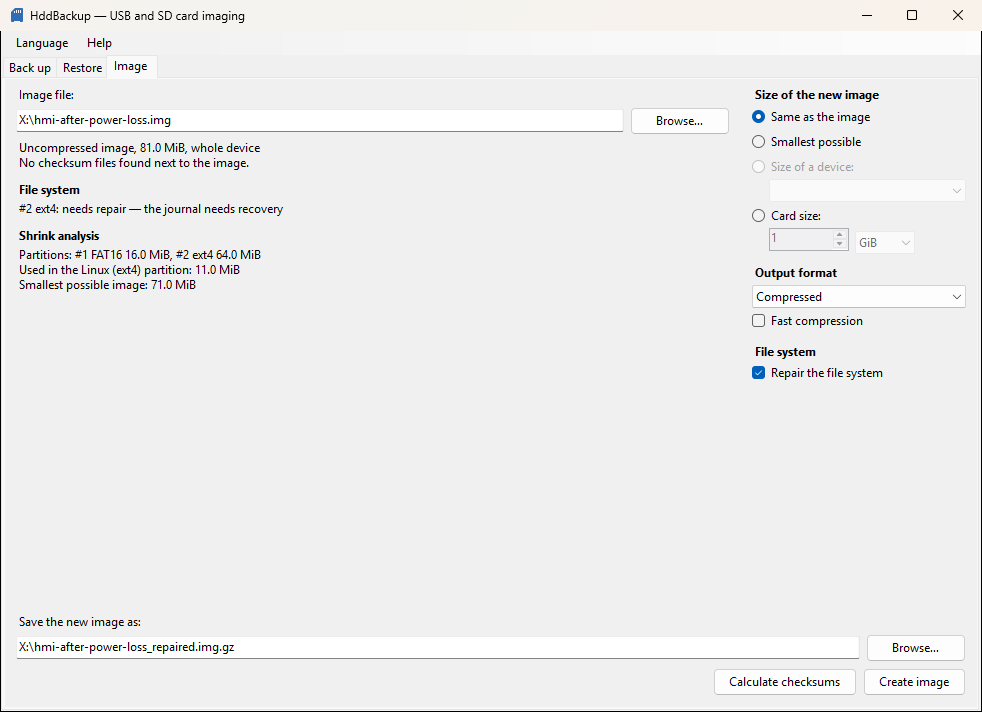
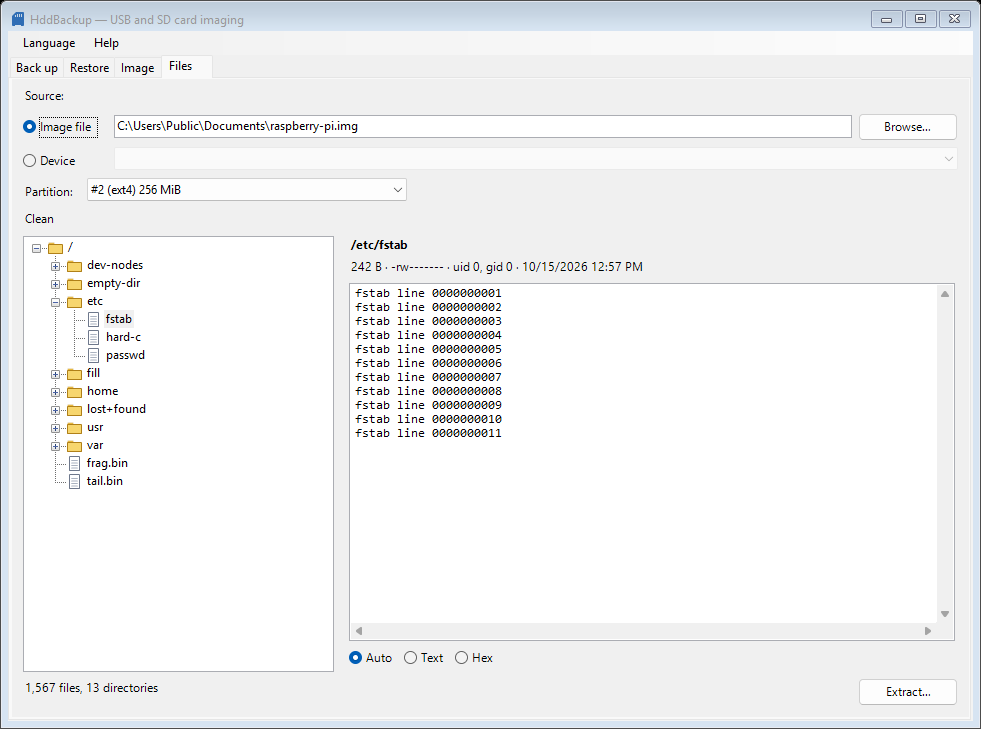
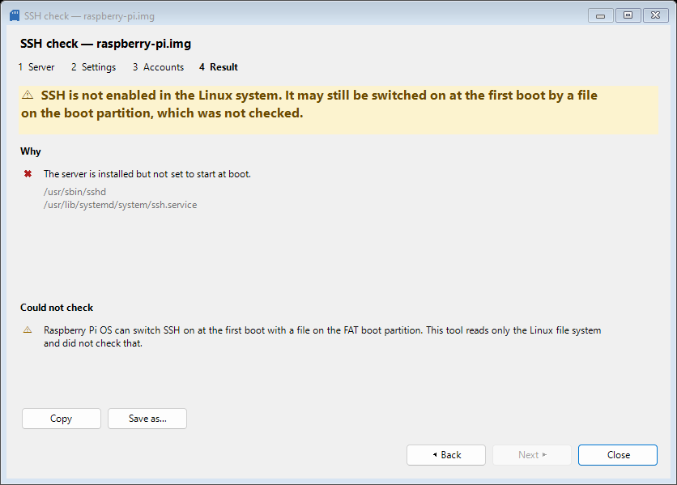
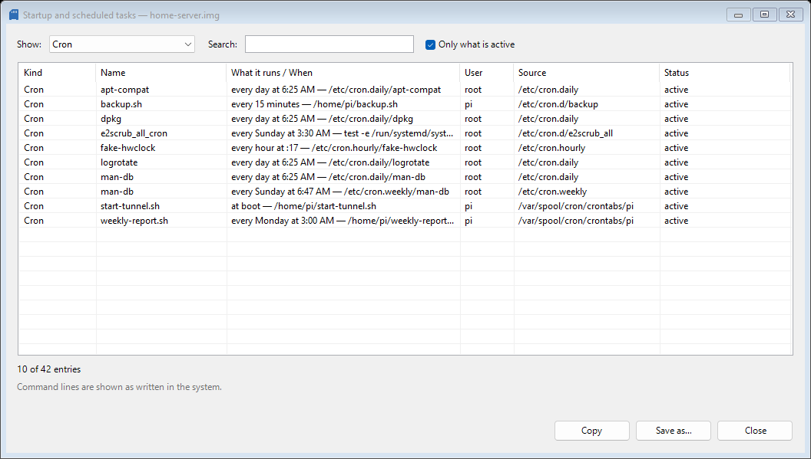

# HddBackup

[](https://github.com/kolod/hdd-backup/actions/workflows/ci.yml)

A compact, portable Windows utility for backing up and restoring USB flash drives and
SD/microSD cards.

- Full-device images: every sector, including the partition table (MBR/GPT) and boot sectors.
- Single-partition images, with a `.partition.json` metadata sidecar.
- Raw `*.img` or gzip-compressed `*.img.gz` images; `.img.gz` is written to a device as a stream,
  with no temporary uncompressed file.
- SHA-256 checksums are computed in the same pass and saved next to the image
  (`disk.img.sha256`; for gzip images also `disk.img.gz.sha256`).
- Progress, current and average speed, elapsed and remaining time. Progress reaches 100% only
  when the device can be removed safely.
- Shrinking Linux images (for example Raspberry Pi OS) so they fit a smaller card: the last
  ext4 partition is rebuilt at a smaller size in a new image file, natively on Windows. On the
  **Image** tab choose the smallest possible size, the size of a connected device, or a card
  size, then **Create image**. The Restore tab warns when an image is larger than the
  selected card and offers "Shrink and write". The original image is never changed.
- The **Image** tab also works on image files without touching a device: convert `.img.gz` to
  `.img` or back (size "Same as the image", choose the other format, **Create image**; the result
  gets its checksum files and is verified before it is kept), verify an image against its
  checksum files, or **Calculate checksums** for an image that has none.
- The **Files** tab opens an image or a USB/SD device, read-only, and shows the ext4 partitions
  as a file tree with a viewer for the selected file. **Extract…** copies a file or a whole
  directory to a folder on your computer, so you can fetch a configuration file from a backup
  without writing the image to a card.
- The **Tools** button next to **Extract…** runs two read-only checks on the opened Linux system:
  an **SSH check** (is the SSH server installed and set to start, who can log in and how) and a
  list of **startup and scheduled tasks** (services, timers, boot scripts, desktop autostart and
  cron, with the schedule in words). They only read, never change anything, and never show
  passwords or keys.
- UI languages: English, Ukrainian, German, French, Spanish, Japanese.

## Screenshots

**Back up** — choose the device on the left, the options on the right, the image file at the
bottom:



**Restore** — the target device, the read-back verification, and the image with its checksum
files:



**Image** — work on an image file without touching a device: convert, shrink, verify or
calculate checksums, and repair the file system of a card that lost power:



**Files** — browse the ext4 partition of an image or a device, view a file, extract a file or a
directory:



**Tools → SSH check** — will SSH work on this card, and if not, why:



**Tools → Startup and scheduled tasks** — everything that starts by itself, with its schedule in
words:



## Disclaimer

HddBackup writes directly to disks. Restoring an image overwrites **all** data on the target
device, and a wrong choice of device cannot be undone. Check the selected device before every
write and keep copies of important data elsewhere.

The software is provided "as is", without warranty of any kind. The author is not liable for
any loss of data, hardware damage, or financial or other losses arising from its use. See
sections 15–16 of the [LICENSE](LICENSE).

## Requirements

- Windows 7 SP1, 8.1, 10 or 11 (x86 or x64).
- .NET Framework 4.8 (preinstalled on Windows 10 1903+ and Windows 11; on Windows 7 SP1 and
  8.1 it must be installed once).
- Administrator rights (the program asks for elevation at start).

The program is a single `HddBackup.exe`. It needs no installation and writes nothing to the
registry. Settings are kept in an optional `HddBackup.ini` next to the executable.

## Build and test

```powershell
dotnet build HddBackup.sln -c Release -warnaserror
dotnet test  tests/HddBackup.Core.Tests -c Release
Invoke-Pester tools/tests            # scripts used by CI and releases (Pester 5)
```

The executable is produced at `src/HddBackup.App/bin/Release/net48/HddBackup.exe`.

Every pull request and push to `main` runs the same build and tests on GitHub Actions (`CI`),
plus an independent check of the ext4 images produced by the tests with the Linux `e2fsck`.
Changes reach `main` only through pull requests with green checks. How releases are made:
[docs/releasing.md](docs/releasing.md).

## Releases

Download `HddBackup.exe` from the
[GitHub Releases page](https://github.com/kolod/hdd-backup/releases). Every release lists the
SHA-256 of its files in the release text and in `SHA256SUMS`; check your download with:

```powershell
Get-FileHash .\HddBackup.exe          # or: certutil -hashfile HddBackup.exe SHA256
```

Releases are published only after the manual hardware checklist has passed, and published
releases cannot be changed afterwards. The executable is not code-signed, so Windows SmartScreen
may warn about an unrecognized app the first time it runs.

## Safety

Only USB, SD and MMC disks are listed. Disks that hold Windows, the boot partition or a page
file are never shown. The disk the program itself runs from is never offered as a write target.
Every write needs an explicit confirmation, and every volume on the target is locked and
dismounted first.

## Known limitations

Some old built-in card readers report a wrong capacity for SDHC/SDXC cards. For example, a
Ricoh R5C843 with the `rimmptsk` driver on Windows 7 reports a 16 GB card as 256 MB. Windows
then refuses to read past the reported size, and that driver does not support SCSI
pass-through, so no program can read the rest of the card through it. HddBackup detects
partitions that extend past the reported size. It shows such a device greyed out as an
"unsuitable reader" and refuses every backup and restore through it. For comparison purposes
a backup can still be forced with "Back up anyway (incomplete image)". The result is then marked
as incomplete. Restoring through such a reader is never allowed. Use a USB card reader for
such cards. **Help → Device diagnostics…** shows the details.

This check relies on the partition table. A reader that misreports the capacity of a card
whose partitions all fit within the reported size cannot be detected this way. For such cards,
compare the SHA-256 of images made with two different readers.

### Shrinking images

Shrinking works on full-device images with an MBR or GPT table whose **last** partition holds
ext4, as in Raspberry Pi OS and most single-board-computer images. Partitions before it (such as
the FAT32 boot partition) are copied byte for byte. The ext4 file system is rebuilt rather than
resized in place, and the result is checked before it is kept: a full metadata check, a
comparison of every file, directory, link, owner, permission and extended attribute with the
source, and a byte comparison of everything before the root partition.

Supported ext4 features: `has_journal`, `ext_attr`, `resize_inode`, `dir_index`, `filetype`,
`extent`, `64bit`, `flex_bg`, `metadata_csum` (+ `metadata_csum_seed`), `sparse_super`,
`large_file`, `huge_file`, `uninit_bg`, `dir_nlink`, `extra_isize`; 1, 2 or 4 KiB blocks;
128- or 256-byte inodes.

### Repairing after an unclean shutdown

Single-board computers are often switched off by pulling the power, leaving the ext4 root
file system with an unreplayed journal, orphan inodes (files deleted while still open) and stale
free space counts. The **Image** tab shows this under **File system** and offers **Repair the
file system**: with **Same as the image** it creates a repaired copy, with a shrink size a
repaired and shrunk image, and "Shrink and write" on the Restore tab repairs automatically. The
repair replays the complete journal transactions (an incomplete last one is discarded, as Linux
does), leaves orphan inodes out and rebuilds the file system clean; the result is checked like a
shrunk image. The original image is never changed and nothing is repaired on a card directly:
back the card up, repair the image and write it back.

Only this kind of damage is repaired. Anything else (for example directory entries pointing to
invalid inodes, blocks used twice, wrong link counts, or errors recorded by the kernel) is
reported with the problems found; repair such a card with a Linux file system check (`e2fsck`)
and back it up again. Only the last (root) ext4 partition is repaired.

Images are refused, with the reason shown, when:
- the file system needs repair and **Repair the file system** is not selected;
- the file system has recorded errors or damage beyond an unclean shutdown;
- it uses other features, such as `inline_data`, `bigalloc`, `encrypt`, `casefold` or
  `quota`;
- ext4 is not the last partition, or there are extended (logical) partitions;
- the data would not fit even at the smallest possible size.

The smallest result is the used data plus a journal and free space of 5% of the data or
128 MiB, whichever is larger (less for very small images). The shrink needs free space in the output folder for the result
and, for an `.img.gz` source, for a temporary uncompressed copy. The temporary copy is deleted
afterwards.

### Browsing and extracting files

The **Files** tab reads an uncompressed `.img` image (a whole-device image or a single-partition
image) or a USB/SD device and lists its ext4 partitions. Nothing is ever written to the image or
the device, and a device is neither locked nor dismounted. A compressed `.img.gz` image is not
opened: convert it to `.img` on the **Image** tab first. Other file systems, such as the FAT
boot partition of a Raspberry Pi card, are listed but cannot be browsed.

- The tree shows directories and files; symbolic links show their target. Selecting a file
  shows its beginning (up to 1 MiB as text, or 256 KiB as a hex dump) and its size, permissions,
  owner and modification time.
- A file system that was not cleanly unmounted (for example a Raspberry Pi card whose power was
  pulled) is shown as it is on disk, with a warning. The journal is **not** replayed, so recent
  changes may be missing. Repair the image on the **Image** tab first to see them. Unreadable
  entries are marked and do not stop the rest.
- **Extract…** copies the selected file or directory with all its contents, keeping the
  contents and modification times. Existing files are replaced only after you choose to, and
  the free space is checked first. Ownership, permissions and extended attributes cannot be
  represented on Windows and are not recreated. Symbolic links, device files, FIFOs and sockets
  are not created. Names that Windows cannot store (such as `a:b`, `CON` or a trailing dot) are
  changed in a predictable way, and a file of 4 GiB or more cannot go to a FAT32 destination.
  Everything that was skipped, renamed or failed is listed with its reason.
- An extraction can be cancelled at any time. A file is written under a temporary name and
  renamed when complete, so no half-written file looks finished.

### Tools: SSH check, startup and scheduled tasks

The **Tools** button of the **Files** tab is enabled whenever a file system is open. Both tools
read the files of the opened Linux system (inside the image, following its symbolic links), on
their own read-only handle; nothing is written, locked or dismounted, and nothing is sent anywhere.

- **SSH check…** is a four-step wizard: *Server* (is an OpenSSH server installed, and is it set to
  start at boot, by socket, or by old init scripts), *Settings* (port, administrator login,
  password and key login, user restrictions, each with the file and line it comes from or
  "default"), *Accounts* (shell, password state, number of authorized keys and whether the account
  can log in) and *Result*: one of "SSH should work: pi — a password and a key", "will not start
  by itself", "no server installed", "the server is set up but nobody can log in", or "cannot be
  determined", with the reasons in the order a person would fix them. It only advises; it never
  changes the image. Network, firewall and `Match` blocks (which depend on who connects from where)
  are not evaluated; `Match` settings are reported as notes. A Raspberry Pi can also switch SSH on
  at the first boot through a file on the FAT boot partition, which is not read, so the result then
  says "not enabled in the Linux system, may still be switched on at the first boot" rather than
  "SSH is off".
- **Startup and scheduled tasks…** lists, in one filterable and searchable table, the systemd
  services, timers and sockets that really start (enabled and reachable from the default target),
  per-user systemd units, `/etc/rc.local` and old init scripts, desktop autostart entries
  (`.desktop`, LXDE and labwc autostart) and cron tasks (`/etc/crontab`, `/etc/cron.d`, user
  crontabs, anacron and the `cron.hourly/daily/weekly/monthly` directories, with the schedule in
  words such as "every day at 6:25 AM"). Entries that will **not** run (masked, in a target that
  is not reached, hidden, not executable, ignored by cron because of the file name, for a user
  that does not exist) are hidden by default; clear **Only what is active** to see them with the
  reason. Command lines are shown exactly as they are written in the system.
- Both windows have **Copy** and **Save as…** (UTF-8 text; saving never replaces a file without
  asking). Password hashes, keys and private key files are never read into a result, so they cannot
  appear in the window, the clipboard or a saved report.
- Only ext4 partitions are analysed; the FAT boot partition is not read. A partition that is not
  the root of a Linux system ("no system configuration was found") and a file system that was not
  cleanly unmounted (shown with the same warning as in the tree) are reported honestly.

Hardware validation steps: [docs/manual-hardware-checklist.md](docs/manual-hardware-checklist.md).
Design documents: [specs/001-usb-sd-imaging/](specs/001-usb-sd-imaging/),
[specs/002-ext4-image-shrink/](specs/002-ext4-image-shrink/),
[specs/008-ext4-browser/](specs/008-ext4-browser/),
[specs/009-image-diagnostic-tools/](specs/009-image-diagnostic-tools/).

## License

Copyright © 2026 Oleksandr Kolodkin.

HddBackup is free software: you can redistribute it and/or modify it under the terms of the
GNU General Public License as published by the Free Software Foundation, either version 3 of
the License, or (at your option) any later version. It is distributed WITHOUT ANY WARRANTY.
See [LICENSE](LICENSE) and [THIRD-PARTY-NOTICES.md](THIRD-PARTY-NOTICES.md).
